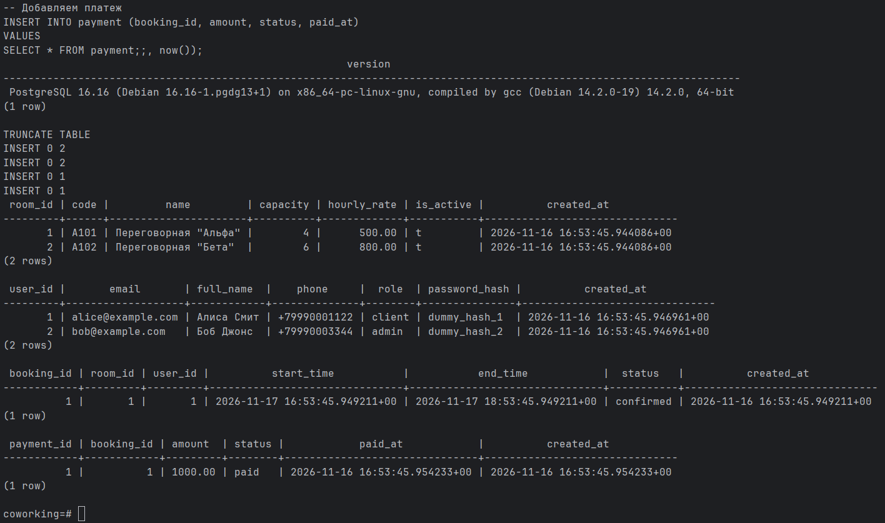
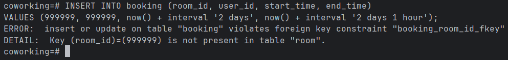

## Выбор СУБД

### Сравнительная таблица

| Критерий | PostgreSQL | MySQL | SQL Server / Oracle |
|---|---|---|---|
| **Модель данных и JSONB** | Гибридная: реляционная + `JSONB` (бинарный формат, индексируется GIN). JSONB оптимизирован для обработки, поддерживает операторы `@>`, `<@`, `?` и сложные пути. | Реляционная + `JSON` (бинарный формат, но индексация ограничена генеративными колонками или multi-valued индексами). Сложные вложенные запросы по JSON без предопределённого пути — слабое место. | SQL Server: реляционная + `JSON` (текстовый, без нативного индекса, только вычисляемые колонки). Oracle: реляционная + `JSON` (с ограничениями в зависимости от редакции). |
| **Транзакции и MVCC / уровни изоляции** | «Чистый» MVCC: старые версии строк остаются в таблице, очищаются `VACUUM`. Поддержка всех 4 уровней, включая `SERIALIZABLE` без фантомов. По умолчанию `READ COMMITTED`. | MVCC через `undo log`: в таблице только последняя версия, старые восстанавливаются по требованию. Поддержка 4 уровней; по умолчанию `REPEATABLE READ` (защищает от фантомов через gap-locks, но не от write skew). | SQL Server: MVCC включается опционально (`READ COMMITTED SNAPSHOT`), иначе — блокировки. Oracle: MVCC через undo, по умолчанию `READ COMMITTED`. |
| **Ограничения целостности (FK, CHECK, exclusion)** | **FK, CHECK, UNIQUE, NOT NULL — полностью.** **EXCLUDE USING GIST** — нативный механизм запрета пересечения диапазонов (идеально для броней). CHECK-ограничения реально проверяются. | FK и UNIQUE есть. **CHECK поддерживается только с версии 8.0.16 и позже**; в старых версиях парсится, но игнорируется. **Exclusion constraint отсутствует** — пересечение броней можно запретить только триггером или логикой приложения, что не гарантирует защиту на уровне БД. | FK и CHECK есть. **Exclusion constraint отсутствует** в обеих СУБД. Пересечение диапазонов — только триггер или приложение. |
| **RLS и безопасность** | Нативный **Row-Level Security**: `ENABLE ROW LEVEL SECURITY` + `CREATE POLICY`. Политики привязываются к таблице и срабатывают автоматически для всех запросов. | **RLS отсутствует**. Изоляция строк — только через представления (`VIEW`) с `WHERE`, но пользователь может обойти представление и обратиться к базовой таблице, если есть прямой `GRANT`. | SQL Server: **RLS есть** через `SECURITY POLICY` (предикаты), но реализация отличается от PostgreSQL и требует больше ручной настройки. Oracle: **VPD** (Virtual Private Database) — мощно, но только в Enterprise-редакции. |
| **Экосистема и инструменты (EXPLAIN, pg_stat_statements)** | `EXPLAIN (ANALYZE, BUFFERS)`, `pg_stat_statements` (встроенный модуль статистики запросов), `auto_explain`, `pgBadger`. Полностью бесплатно. | `EXPLAIN ANALYZE`, `Performance Schema`, slow query log. `pg_stat_statements`-аналога уровня PostgreSQL нет; статистика менее удобна для агрегированного анализа. | SQL Server: `SET STATISTICS PROFILE`, `Query Store`, graphical plans, Database Engine Tuning Advisor — очень сильная экосистема, но **платная** (кроме Express). Oracle: `AWR`, `ASH` — индустриальный стандарт, но дорого. |
| **Стоимость / облако** | **Полностью бесплатно** (PostgreSQL License, MIT/BSD-подобная), без ограничений по коммерческому использованию. В облаке (RDS, Cloud SQL, Azure) — самый дешёвый вариант среди трёх. | Community Edition — бесплатно (GPL). Enterprise — платно (несколько тысяч — десятки тысяч $/год). В облаке — дешевле SQL Server, но дороже PostgreSQL в некоторых провайдерах. | SQL Server: **$931–$14 256 за ядро** (Standard/Enterprise, минимум 2 ядра) или Server + CAL. Express — бесплатно, но лимит 10 ГБ и 4 ядра. Oracle: значительно дороже SQL Server. |

### Вывод: выбираем PostgreSQL 16

1. **Ключевой аргумент — ограничение 5.1 (запрет пересечения броней).** В PostgreSQL это реализуется одной DDL-конструкцией `EXCLUDE USING GIST (room_id WITH =, tstzrange(start_time, end_time) WITH &&)`, и СУБД сама гарантирует невозможность двойной брони даже при одновременных вставках. MySQL и SQL Server такой механизм **не поддерживают** — там пришлось бы писать триггеры, которые сложнее в поддержке и не дают такой же гарантии на уровне ядра.
2. **RLS закрывает требование 7 (изоляция по ролям).** Клиент должен видеть только свои брони — в PostgreSQL это делается нативной политикой `CREATE POLICY`, а не костылями через представления, которые можно обойти прямым запросом к таблице. У MySQL RLS нет вовсе; у SQL Server есть, но экосистема платная.
3. **Профиль нагрузки (OLTP + OLAP) ложится на PostgreSQL без компромиссов.** Для OLTP — надёжные короткие транзакции и `READ COMMITTED` по умолчанию; для OLAP — богатый планировщик, `EXPLAIN (ANALYZE, BUFFERS)` и `pg_stat_statements` для поиска медленных агрегатов. JSONB пригодится, если позже понадобится хранить гибкие метаданные броней без миграций схемы.
4. **Стоимость нулевая, а требования к доступности (99.5 %) и RPO/RTO достигаются стандартными средствами** (WAL-архивирование, потоковая репликация) без лицензионных платежей.
5. **Ограничения 5.2–5.10 (CHECK, FK, UNIQUE) PostgreSQL поддерживает полностью и без оговорок**, тогда как в MySQL исторически были проблемы с реальной проверкой `CHECK` (до 8.0.16), а SQL Server / Oracle не дают exclusion constraint и стоят дорого для учебного проекта.


## SQL vs NoSQL

### Выбранный сценарий: журнал событий по броням (booking_events)

Каждое изменение брони порождает событие: `created`, `paid`, `confirmed`, `cancelled`, `refund_issued`. События нужны для:
- разбора конфликтов и обращений клиентов («почему бронь отменилась?»);
- отчёта по воронке отмен (сценарий 7, OLAP);
- аудита действий администратора (сценарий 6, требование 7).

### Какие запросы нужны

| № | Запрос | Частота |
|---|---|---|
| Q1 | Все события по конкретной брони, по порядку времени | Часто (карточка брони) |
| Q2 | Последнее событие по каждой брони за период (для статуса/воронки) | Часто (отчёт) |
| Q3 | Агрегат: сколько отмен по причине X за месяц, по комнатам | Редко (OLAP) |
| Q4 | События конкретного пользователя (история в ЛК) | Часто |
| Q5 | Поиск событий по гибким атрибутам payload (например, `payload->>'reason' = 'no_payment'`) | Редко |

### Нужны ли JOIN и транзакции

- **JOIN:** Q2 и Q3 требуют join с `booking`/`room` — агрегаты по комнатам и статусам невозможно посчитать, не подтянув измерения. Q1/Q4 — join с `app_user` для проверки владельца (RLS или `WHERE user_id = ...`).
- **Транзакции:** событие пишется **в той же транзакции**, что и изменение статуса брони. Иначе возможна ситуация «бронь отменена, а события `cancelled` нет» (или наоборот). Это критично для аудита — событие и изменение состояния должны быть атомарны.
- **Целостность:** `booking_id` в событии обязан ссылаться на существующую бронь (`FK`). В документной модели эта связь обеспечивается только логикой приложения.

### Схема в реляционном варианте (PostgreSQL)

```sql
CREATE TABLE booking_event (
  event_id    BIGSERIAL PRIMARY KEY,
  booking_id  BIGINT NOT NULL REFERENCES booking(booking_id) ON DELETE CASCADE,
  event_type  TEXT NOT NULL CHECK (event_type IN
                ('created','paid','confirmed','cancelled','refund_issued')),
  actor_id    BIGINT REFERENCES app_user(user_id),  -- NULL для системных событий
  payload     JSONB NOT NULL DEFAULT '{}'::jsonb,   -- гибкие детали
  created_at  TIMESTAMPTZ NOT NULL DEFAULT now()
);

CREATE INDEX ix_booking_event_booking_time ON booking_event (booking_id, created_at);
CREATE INDEX ix_booking_event_payload_gin   ON booking_event USING gin (payload);
```

- Q1 — индекс `(booking_id, created_at)`, обычный `SELECT ... ORDER BY created_at`.
- Q2 — `DISTINCT ON (booking_id) ... ORDER BY booking_id, created_at DESC` или оконная функция `row_number()`.
- Q3 — обычный `GROUP BY` с join на `booking` и `room`.
- Q5 — GIN-индекс по `payload`, `WHERE payload @> '{"reason":"no_payment"}'`.

### Схема в документной модели (MongoDB-подобная)

Два разумных варианта:

**Вариант A — отдельная коллекция `booking_events`:**
```json
{
  "_id": ObjectId("..."),
  "booking_id": 42,
  "event_type": "cancelled",
  "actor_id": 7,
  "payload": { "reason": "no_payment", "refund": 0 },
  "created_at": ISODate("2026-11-15T10:00:00Z")
}
```
- Q1/Q4 — индекс по `booking_id` + сортировка по `created_at`, работает быстро.
- Q2 — `$group` + `$sort` + `$first` в aggregation pipeline.
- Q3 — `$lookup` (аналог JOIN) на `bookings`/`rooms` **или** денормализация `room_id`/`room_code` прямо в событие.
- Q5 — запрос по вложенному полю, работает через обычный индекс.

**Вариант B — события как вложенный массив в документе брони:**
```json
{
  "_id": 42,
  "user_id": 7,
  "room_id": 3,
  "status": "cancelled",
  "events": [
    { "type": "created",   "at": "..." },
    { "type": "paid",      "at": "..." },
    { "type": "cancelled", "at": "...", "payload": { "reason": "no_payment" } }
  ]
}
```
- Q1 — тривиально (документ уже содержит историю), но **документ растёт**; при долгой жизни брони можно упереться в лимит 16 МБ (MongoDB) и в стоимость обновления всего документа.
- Q2/Q3 — плохо: агрегаты по всем броням требуют `$unwind` массива событий, что дорого на сотнях тысяч броней.
- Q4 — нужен индекс по `user_id`.

### Сравнение по критериям задания

| Критерий | Реляционный (PostgreSQL) | Документный (MongoDB) |
|---|---|---|
| Q1 (события по брони) | Индекс `(booking_id, created_at)`, простой `SELECT` | Оба варианта ок; вариант B — самый быстрый, но растёт документ |
| Q2 (последнее событие по брони) | `DISTINCT ON` / оконная функция, планировщик хорошо оптимизирует | `$group`/`$first`, работает, но менее предсказуемо по плану |
| Q3 (агрегат по комнатам) | `JOIN` + `GROUP BY`, естественно | Нужен `$lookup` или денормализация `room_id` в каждом событии |
| Q4 (история пользователя) | `JOIN booking ON user_id`, индекс | Индекс по `user_id` (вариант B) или `$lookup` (вариант A) |
| Q5 (гибкий payload) | `JSONB` + GIN — нативно | Гибкая схема — нативно, без миграций |
| Целостность FK | Гарантия на уровне БД | Только на уровне приложения |
| Атомарность «событие + смена статуса» | Одна транзакция | Много-документная транзакция есть в MongoDB 4.0+, но дороже и не всегда доступна в managed-кластерах |
| Объёмы (сотни тысяч событий/год) | Индексы + партиционирование при необходимости | Растёт линейно, нужен шардинг/TTL раньше |

### Вывод: реляционная модель (PostgreSQL + `JSONB`)

1. **Связь `booking_event → booking` — обязательная, и она должна проверяться БД.** Событие без существующей брони — это битые данные и сломанный аудит; FK в PostgreSQL гарантирует это на уровне ядра, а в документной модели — только код приложения, который можно обойти.
2. **Q2 и Q3 (отчёты) — это OLAP по требованиям 6**, и они выигрывают от `JOIN` с `booking`/`room` и от планировщика PostgreSQL. В документной модели эти же отчёты требуют `$lookup` или денормализации, что увеличивает объём и усложняет согласованность.
3. **Атомарность «изменение статуса + запись события»** в требованиях не обсуждается, но подразумевается аудитом: в PostgreSQL это одна транзакция, в MongoDB — multi-document transaction, которая дороже и не всегда включена в managed-окружении.
4. **Гибкость payload не требует перехода на NoSQL:** `JSONB` + GIN-индекс в PostgreSQL закрывают Q5 (поиск по `payload->>'reason'`) без потери целостности остальной схемы. Это классический компромисс: документная часть — только там, где действительно нет фиксированной схемы.
5. **Объёмы (сотни тысяч событий в год) для PostgreSQL — это малые данные**, партиционирование по `created_at` при необходимости добавляется без переписывания модели. Для MongoDB на тех же объёмах тоже нормально, но выигрыша по производительности нет, а по целостности — проигрыш.

**Итог:** для журнала событий броней выбираем **реляционную модель с `JSONB`-полем под гибкие атрибуты**. Документная БД оправдана только если бы события были полностью независимы (например, сырые логи приложения без связи с броней) — но это не наш случай.

## Smoke-тест

### Успешное выполнение



### Негативный тест FK


